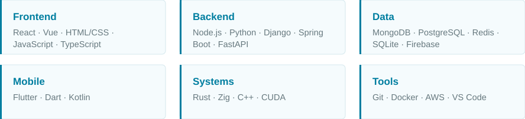
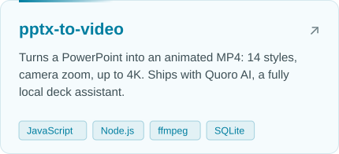
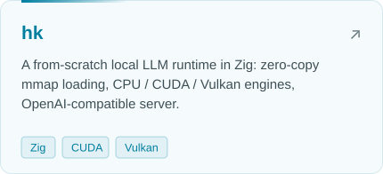
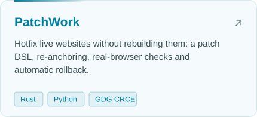
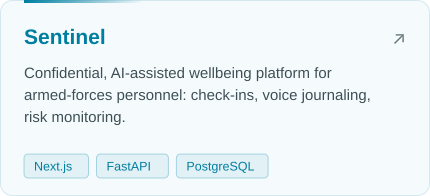
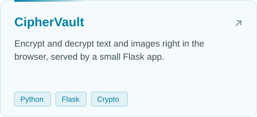
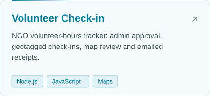

  
  
  
  

<picture><source media="(prefers-color-scheme: dark)" srcset="assets/h-about-dark.svg"></picture>

I'm John, a Computer Engineering student at **Fr. CRCE, Mumbai** who likes building things end to end:
the interface people touch, the server behind it, and lately the layers underneath that.

- 🛠️ **Right now:** turning PowerPoint decks into animated videos, a local LLM runtime in Zig, and a system that hotfixes live websites
- 🎨 **I care about:** clean code and user-centred design, and making things that feel fast
- 🌱 **Learning:** systems programming (Rust, Zig, CUDA) and how ML models actually run on hardware
- 🤝 **Open to:** hackathon teams, internships and collaborating on anything web, mobile or AI

<picture><source media="(prefers-color-scheme: dark)" srcset="assets/h-stack-dark.svg"></picture>

  <picture><source media="(prefers-color-scheme: dark)" srcset="assets/skills-dark.svg"></picture>

<picture><source media="(prefers-color-scheme: dark)" srcset="assets/h-projects-dark.svg"></picture>

  <a href="https://github.com/JohnThrisokaran000/pptx-to-video"><picture><source media="(prefers-color-scheme: dark)" srcset="assets/card-pptx-to-video-dark.svg"></picture></a>
  <a href="https://github.com/JohnThrisokaran000/hk"><picture><source media="(prefers-color-scheme: dark)" srcset="assets/card-hk-dark.svg"></picture></a>
  <a href="https://github.com/JohnThrisokaran000/Shotgun_college_round"><picture><source media="(prefers-color-scheme: dark)" srcset="assets/card-patchwork-dark.svg"></picture></a>
  <a href="https://github.com/JohnThrisokaran000/mentalhealthfinal"><picture><source media="(prefers-color-scheme: dark)" srcset="assets/card-sentinel-dark.svg"></picture></a>
  <a href="https://github.com/JohnThrisokaran000/Cipher_Vault"><picture><source media="(prefers-color-scheme: dark)" srcset="assets/card-ciphervault-dark.svg"></picture></a>
  <a href="https://github.com/JohnThrisokaran000/cep-registration"><picture><source media="(prefers-color-scheme: dark)" srcset="assets/card-volunteer-dark.svg"></picture></a>

<picture><source media="(prefers-color-scheme: dark)" srcset="assets/h-building-dark.svg"></picture>

<table>
  <tr>
    <td width="33%"><b>Spatium</b> Smart parking with live slot visibility and booking <code>Flutter</code> <code>Firebase</code></td>
    <td width="33%"><b>Synesis</b> A tech club for collaborative projects and learning <code>React</code> <code>Node.js</code> <code>MongoDB</code></td>
    <td width="33%"><b>Taskly</b> Task manager with a modern UI <code>Flutter</code> <code>Dart</code> <code>SQLite</code></td>
  </tr>
</table>

<picture><source media="(prefers-color-scheme: dark)" srcset="assets/h-journey-dark.svg"></picture>

  <picture><source media="(prefers-color-scheme: dark)" srcset="assets/journey-dark.svg"></picture>

<picture><source media="(prefers-color-scheme: dark)" srcset="assets/h-off-dark.svg"></picture>

🎧 Music &nbsp;·&nbsp; 🚶 Long walks &nbsp;·&nbsp; 📷 Photography &nbsp;·&nbsp; ⚽ Football

<picture><source media="(prefers-color-scheme: dark)" srcset="assets/divider-dark.svg"></picture>

Built to match <a href="https://johnthrisokaran000.github.io/portfolio/">my portfolio</a>. The graphics are generated by <code>scripts/build.mjs</code>.

