<p align="center">
  
</p>

<p align="center">
  <a href="#fight"></a>
  <a href="#act"></a>
  <a href="#item"></a>
  <a href="#mercy"></a>
</p>

<br>

<a name="fight"></a>


Select a project to open its repository.

<a href="https://github.com/JohnThrisokaran000/pptx-to-video"></a>

<a href="https://github.com/JohnThrisokaran000/hk"></a>

<a href="https://github.com/JohnThrisokaran000/Shotgun_college_round"></a>

<a href="https://github.com/JohnThrisokaran000/mentalhealthfinal"></a>

<a href="https://github.com/JohnThrisokaran000/Cipher_Vault"></a>

<a href="https://github.com/JohnThrisokaran000/cep-registration"></a>

<br>

<a name="act"></a>


<p align="center"></p>

<br>

<a name="item"></a>


<p align="center"></p>

<br>

<a name="run"></a>


<p align="center"><a href="https://johnthrisokaran000.github.io/JohnThrisokaran000/play/"></a></p>

<p align="center"><a href="https://johnthrisokaran000.github.io/JohnThrisokaran000/play/"><b>PLAY IT</b></a>: space, up arrow, click or tap to jump. Or scroll the track below.</p>

<!-- track:start -->
```text
                                .--.                                                                                                                    .--.                                                                                                                                        .--.
  HI 00820  00000             .(    ).                                                            .--.                                                .(    ).                                                        .--.                                                                        .(    ).
                              (_______)                                                         .(    ).                                              (_______)            __                                       .(    ).                                                                      (_______)                       GAME OVER?
                                                 [ CIPHERVAULT ]           __            [ VOLUNTEER CHECK-IN ]                                 [ SENTINEL ]              <__\___                 [ PATCHWORK ]     (_______)                        [ HK ]                  __               [ PPTX-TO-VIDEO ]
            .-----.                                                       <__\___                                                                                             \/                                                                                            <__\___                                                NO. SHIPPED.
            | o   |                                    _                      \/                   _                                                 _                                                 _                                               _                        \/                   _
            |  .--'     SCROLL  >>>                  _| | _                                      _| | _                                            _| | _                                            _| | _                                          _| | _                                        _| | _
   \        |  |--.                                 | | || |                                    | | || |                                          | | || |                                          | | || |                                        | | || |                                      | | || |                             *
    \.------'  |                                    |_  ,_/                                     |_  ,_/                                           |_  ,_/                                           |_  ,_/                                         |_  ,_/                                       |_  ,_/                             ***
     \_       _/                                      | |                                         | |                                               | |                                               | |                                             | |                                           | |                              *****
       |_|  |_|                                       | |                                         | |                                               | |                                               | |                                             | |                                           | |                               | |
____________________________________________________________________________________________________________________________________________________________________________________________________________________________________________________________________________________________________________________________________________________
.          -     ,     .     -     ,          .     -     ,     .     -          ,     .     -     ,     .          -     ,     .     -     ,          .     -     ,     .     -          ,     .     -     ,     .          -     ,     .     -     ,          .     -     ,     .     -          ,     .     -     ,     .          -     ,     .
```
<!-- track:end -->

<br>

<a name="ioccc"></a>


<p align="center"></p>

<!-- ioccc:start -->
```c
                int/**/putchar(int);
                void/**/p(char*q){
           while(*q)putchar(*q++);}int
        main(int/**/c,char**v){int/**/i,j,k,n
      ,F;double/**/x,y,a,b,t,s;volatile/**/long
      w;char*r=" .:-=+*#%@";char*m="* you feel"
   " like you're gonna have a good time.";for(F=0;
   F<48||c<        2;F++){if(c<2)p        ("\33[H"
   );for             (s=3,k=F%48             ;k--;
   )s*=              .85;for(j=0             ;j<32
   ;j++)     {       for(i=0;i<      64      ;i++)
   {x=-/**/        .743643887+(i-         32)*s/64
   ;y=.131825904+(j-16)*     s/32;for(a=b=k=0;k<
   2048&&a*a+b*b<4;k++)t=a*a-b*b+x,b=2*a*b+y,a=t;
   for(n=0;n*n<2*k;n++);putchar(k>2047?32:r[1+n%9]
   );}                                       /***/
   putchar(  10)   ;}   p(   m);       putchar(10)
      ;if(c                               >1){
      if(F<                               47)p(
        "\f\n");}else/**/for(w=0;w<30000000;w
                ++);}return/**/0;}
```

`cc -O2 -o sans sans.c && ./sans` to watch it in a terminal. It is a real program: the build compiles it next to [the readable version](ascii/sans.src.c) and checks that both print the same frames.
<!-- ioccc:end -->

<br>

<a name="mercy"></a>


<p align="center">
  <a href="https://www.linkedin.com/in/john-thrisokaran-31844027b/"></a>
  <a href="https://x.com/thrisokaran"></a>
  <a href="mailto:johnjobyt@gmail.com"></a>
  <a href="https://github.com/JohnThrisokaran000?tab=repositories"></a>
</p>

<p align="center"></p>
