<p align="center">
  
</p>

<p align="center">
  <a href="#fight"></a>
  <a href="#act"></a>
  <a href="#item"></a>
  <a href="#mercy"></a>
</p>

<br>

<a name="fight"></a>


Select a project to open its repository.

<a href="https://github.com/JohnThrisokaran000/pptx-to-video"></a>

<a href="https://github.com/JohnThrisokaran000/hk"></a>

<a href="https://github.com/JohnThrisokaran000/Shotgun_college_round"></a>

<a href="https://github.com/JohnThrisokaran000/mentalhealthfinal">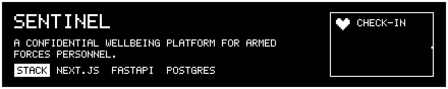</a>

<a href="https://github.com/JohnThrisokaran000/Cipher_Vault"></a>

<a href="https://github.com/JohnThrisokaran000/cep-registration"></a>

<br>

<a name="act"></a>


<p align="center"></p>

<br>

<a name="item"></a>


<p align="center"></p>

<br>


<p align="center"></p>

<br>


<p align="center"></p>

<!-- soul:start -->
<details>
<summary>Read soul.c</summary>

```c
/*
 * soul.c - a beating, spinning ASCII heart (the SOUL), ray marched in plain C.
 *
 * The heart is the implicit surface
 *     (x^2 + 9/4 z^2 + y^2 - 1)^3 - x^2 y^3 - 9/80 z^2 y^3 = 0
 * For every character cell a ray is marched into the scene until it enters the
 * surface, the hit is refined by bisection, and the surface normal (taken from
 * the gradient) is lit and mapped onto a 12-step character ramp.
 *
 *   cc -O2 -o soul soul.c -lm
 *   ./soul             animate in the terminal (Ctrl+C to stop)
 *   ./soul --frames 48 print 48 frames separated by form feeds
 */
#include <math.h>
#include <stdio.h>
#include <stdlib.h>
#include <string.h>
#include <time.h>

#define W 64
#define H 32
#define PI 3.14159265358979323846

static const char RAMP[] = ".,-~:;=!*#$@";

/* Negative inside the heart, positive outside (y is up, z points away from the viewer). */
static double heart(double x, double y, double z) {
    double a = x * x + 2.25 * z * z + y * y - 1.0;
    return a * a * a - x * x * y * y * y - 0.1125 * z * z * y * y * y;
}

/* The scene: the heart turned by `turn` around the vertical axis and scaled by `beat`. */
static double scene(double x, double y, double z, double turn, double beat) {
    double c = cos(turn), s = sin(turn);
    double ox = (x * c + z * s) / beat;
    double oz = (-x * s + z * c) / beat;
    return heart(ox, y / beat, oz);
}

static void frame(char out[H][W + 1], double t) {
    double turn = 2.0 * PI * t;
    double beat = 1.0 + 0.07 * pow(fabs(sin(2.0 * PI * t * 2.0)), 6.0); /* two beats per turn */
    double lx = -0.45, ly = 0.6, lz = -1.0;
    double ll = sqrt(lx * lx + ly * ly + lz * lz);
    lx /= ll; ly /= ll; lz /= ll;

    for (int j = 0; j < H; j++) {
        for (int i = 0; i < W; i++) {
            /* a character is about twice as tall as it is wide, so 64x32 cells map to a square */
            double x = ((i + 0.5) / W * 2.0 - 1.0) * 1.55;
            double y = -((j + 0.5) / H * 2.0 - 1.0) * 1.55 + 0.12;
            char ch = ' ';
            double prev = -2.0;
            for (double z = -2.0; z <= 2.0; z += 0.02) {
                if (scene(x, y, z, turn, beat) <= 0.0) {
                    double lo = prev, hi = z;          /* bisect onto the surface */
                    for (int k = 0; k < 12; k++) {
                        double mid = 0.5 * (lo + hi);
                        if (scene(x, y, mid, turn, beat) <= 0.0) hi = mid; else lo = mid;
                    }
                    double e = 1e-3, f = scene(x, y, hi, turn, beat);
                    double nx = scene(x + e, y, hi, turn, beat) - f;
                    double ny = scene(x, y + e, hi, turn, beat) - f;
                    double nz = scene(x, y, hi + e, turn, beat) - f;
                    double nl = sqrt(nx * nx + ny * ny + nz * nz);
                    double b = nl > 0 ? (nx * lx + ny * ly + nz * lz) / nl : 0.0;
                    if (b < 0) b = 0;
                    ch = RAMP[(int)(b * (sizeof RAMP - 2) + 0.5)];
                    break;
                }
                prev = z;
            }
            out[j][i] = ch;
        }
        out[j][W] = '\0';
    }
}

static void wait_ms(int ms) {
    clock_t end = clock() + (clock_t)ms * CLOCKS_PER_SEC / 1000;
    while (clock() < end) { }
}

int main(int argc, char **argv) {
    static char buf[H][W + 1];
    if (argc == 3 && strcmp(argv[1], "--frames") == 0) {
        int n = atoi(argv[2]);
        for (int f = 0; f < n; f++) {
            frame(buf, (double)f / n);
            for (int j = 0; j < H; j++) puts(buf[j]);
            if (f + 1 < n) puts("\f");
        }
        return 0;
    }
    for (int f = 0;; f = (f + 1) % 96) {
        frame(buf, f / 96.0);
        printf("\x1b[H\x1b[2J");
        for (int j = 0; j < H; j++) puts(buf[j]);
        fflush(stdout);
        wait_ms(40);
    }
}
```

</details>
<!-- soul:end -->

<br>

<a name="mercy"></a>


<p align="center">
  <a href="https://www.linkedin.com/in/john-thrisokaran-31844027b/"></a>
  <a href="https://x.com/thrisokaran"></a>
  <a href="mailto:johnjobyt@gmail.com"></a>
  <a href="https://github.com/JohnThrisokaran000?tab=repositories"></a>
</p>

<p align="center"></p>
